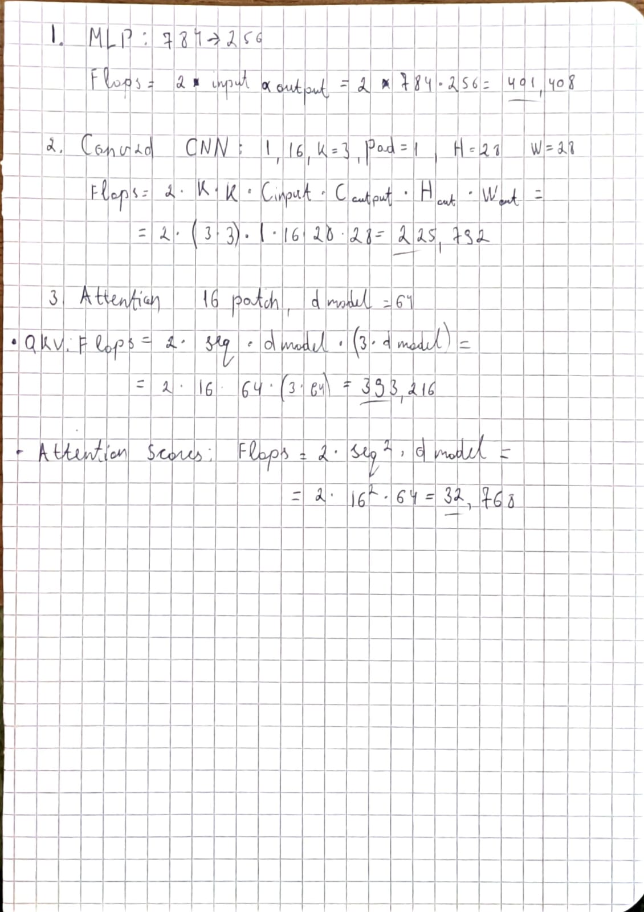

# Lab 03 Report: Comparing Neural Network Architectures and Costs

## 1. Goal

The goal of this lab is to build three different kinds of neural networks in PyTorch (MLP, CNN, and a Vision Transformer with Attention) to recognize clothing items from the Fashion-MNIST dataset. We want to test their test accuracy, count how many dials (parameters) they have, calculate how many math operations (FLOPs) they do, and test how fast they run on single images versus big batches.

## 2. Method

- **Dataset:** Used Fashion-MNIST (60,000 training images, 10,000 test images across 10 clothing types). Scaled the pixel values using mean 0.2860 and std 0.3530. Split the 60k training set into 55,000 for training and 5,000 for validation.
- **The Three Models:**
  1. **MLP:** A flat model that connects all 784 pixels to 256 neurons, then to 128 neurons, and finally to the 10 outputs.
  2. **CNN:** A convolutional model that uses two 3x3 filters (16 channels, then 32 channels) with MaxPool layers to shrink the picture, then a linear layer to the 10 outputs.
  3. **Attention:** Slices each 28x28 image into 16 square patches (7x7 pixels each), turns each patch into a list of 64 numbers, runs them through 2 Transformer encoder layers with 4 attention heads, averages them, and outputs to 10 classes.
- **Testing:**
  - Counted total parameters with `torchinfo.summary`.
  - Hand-calculated math steps (FLOPs) for one layer of each model and compared with `thop.profile`.
  - Tested speed (latency) on CPU for Batch Size 1 (tested 100 times) and Batch Size 128 (tested 20 times), taking the median time.
  - Trained all three models for 5 epochs with Adam optimizer, learning rate 0.001, and batch size 128.

## 3. Results

### Model Numbers Summary

**1. Multi-Layer Perceptron (MLP):**

- Parameters: 235,146 dials
- Total FLOPs (thop): 469,504
- Latency (Single Image / Batch 1): 0.204 ms
- Latency (Batch 128): 0.702 ms
- Test Accuracy (5 Epochs): 87.83%

**2. Convolutional Neural Network (CNN):**

- Parameters: 20,490 dials
- Total FLOPs (thop): 2,063,488
- Latency (Single Image / Batch 1): 0.495 ms
- Latency (Batch 128): 18.781 ms
- Test Accuracy (5 Epochs): 89.75%

**3. Vision Transformer (Attention):**

- Parameters: 70,794 dials
- Total FLOPs (thop): 1,182,976
- Latency (Single Image / Batch 1): 2.212 ms
- Latency (Batch 128): 10.859 ms
- Test Accuracy (5 Epochs): 83.86%

### Hand-Calculated FLOPs vs. Tool Measurements

Here is the handwritten note with the step-by-step math for one layer of each model:

- **MLP Layer (784 -> 256):**
  $2 \times 784 \times 256 = 401,408\text{ FLOPs}$. Adding the other two small layers gives 469,504 FLOPs in total, which matches `thop` exactly.
- **CNN Layer (1 -> 16, 3x3 filter):**
  $2 \times 9 \times 1 \times 16 \times 28 \times 28 = 225,792\text{ FLOPs}$. The full model comes out to 2,063,488 FLOPs, matching `thop` when counting both multiply and addition steps.
- **Attention Layer (16 patches, size 64):**
  QKV projection is $2 \times 16 \times 64 \times 192 = 393,216\text{ FLOPs}$, and comparing all patches is $2 \times 16 \times 16 \times 64 = 32,768\text{ FLOPs}$.
- **Why tool numbers are different from isolated formulas:** The profiling tool measures the whole PyTorch block (including the feedforward layers and normalizations), while the hand formula only looks at the raw matrix multiplications.

## 4. Trade-Offs and Memory Access

1. **Why the CNN is the best here:**
   The CNN got the highest test score (89.75%) even though it had only 20,490 parameters—over 11 times fewer than the MLP! The CNN reuses the same 3x3 filter across the whole picture, so it keeps its small weights in fast CPU cache memory while scanning pixels. It understands shapes without needing millions of separate wires.

2. **Why the MLP is wasteful:**
   The MLP had 235,146 parameters because every pixel has a separate wire to every neuron. It flattens the image into a line, so it doesn't understand that neighbor pixels form shapes. It has to load a huge weight table from memory on every guess, which wastes RAM even though the simple math runs fast for a single picture (0.204 ms).

3. **Why Attention was slower and scored lower:**
   The Attention model scored 83.86% and was the slowest on single images (2.212 ms). Attention has to compare every patch against every other patch, which jumps around memory. Transformers usually need way more training data and hundreds of epochs to shine, so on a small 5-epoch test with tiny 28x28 images, it is overkill.

## 5. Conclusions

- **More dials does not mean smarter:** The MLP had the most parameters (235k) but scored worse than the CNN (20k) because it is blind to 2D image shapes.
- **CNN is the most efficient choice:** It gave the best accuracy with the smallest file size, making it the best model for phones or edge devices.
- **Attention needs scale:** On tiny clothing images, chopping the picture into 16 patches and comparing all pairs takes more latency without beating a simple CNN.
